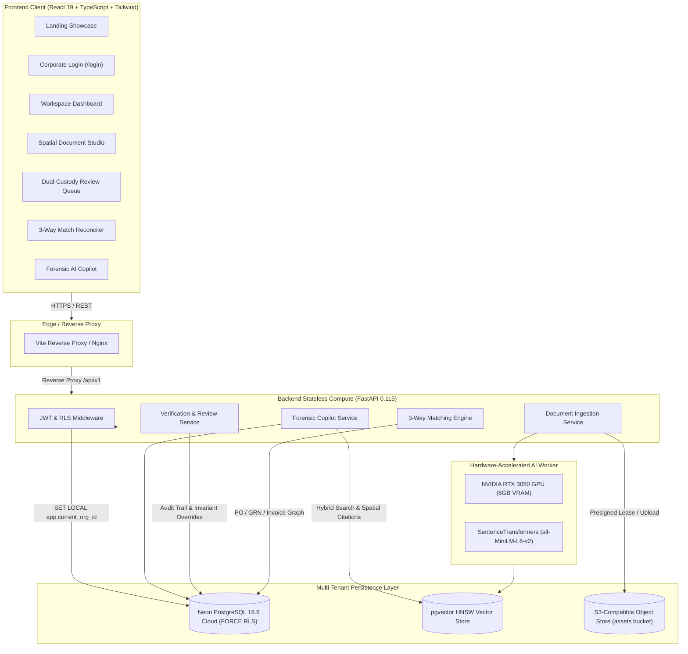
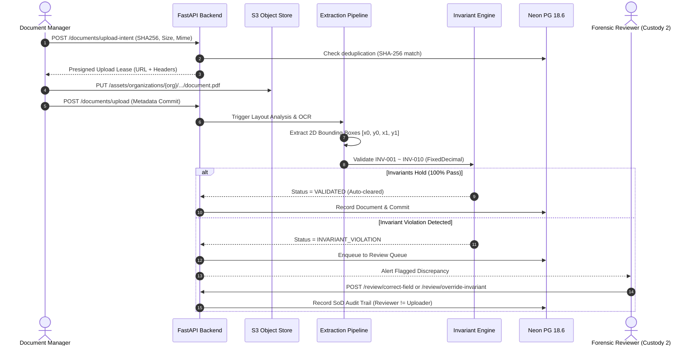

# LedgerOne — System Architecture Specification

**Document Version:** 3.2.0-PROD  
**Architect:** Principal Solutions Architect & Staff Infrastructure Engineer  
**Classification:** Enterprise Multi-Tenant SaaS  

---

## 1. Architectural Philosophy & Principles

LedgerOne is architected according to three uncompromising principles:
1. **Mathematical Financial Invariance:** Financial numbers are never represented as IEEE-754 binary floating-point numbers. All calculations utilize Python's arbitrary-precision `Decimal` with explicit Bankers' Rounding (`ROUND_HALF_EVEN`), guaranteeing exact cent-level arithmetic parity across subtotal, tax, discounts, and total.
2. **Defensive Multi-Tenancy & Zero Trust:** Tenant segregation is enforced at the database kernel level through PostgreSQL `FORCE ROW LEVEL SECURITY (RLS)`. Tenant context is cryptographically derived from signed JWT claims and injected into connection sessions via `SET LOCAL app.current_org_id`.
3. **Cryptographic Dual Custody & Segregation of Duties:** Critical financial disbursements and invoice approvals require multi-party consensus. The system enforces mathematical blocks preventing an individual from approving their own uploads (`AUTH_SOD_001`) or their own manual corrections (`AUTH_SOD_002`).

---

## 2. High-Level System Topology



---

## 3. Data Processing & Document Ingestion Pipeline



---

## 4. Multi-Tenant Isolation & Row-Level Security (RLS)

Tenancy is modeled around two organizational primitives:
1. **Organizations:** The top-level administrative boundary (Tenant).
2. **Workspaces:** Isolated project or departmental silos within an Organization.

### PostgreSQL RLS Implementation Pattern
Every multi-tenant table (`documents`, `invoices`, `review_queue`, `assistant_sessions`, `discrepancies`) enforces RLS:
```sql
ALTER TABLE documents ENABLE ROW LEVEL SECURITY;
ALTER TABLE documents FORCE ROW LEVEL SECURITY;

CREATE POLICY tenant_isolation_policy ON documents
    FOR ALL
    USING (
        organization_id = NULLIF(current_setting('app.current_org_id', true), '')::uuid
        OR NULLIF(current_setting('app.is_platform_admin', true), 'false')::boolean = true
    );
```

When an HTTP request enters the backend, `src/middleware.py` and `src/db/rls.py` extract the validated JWT claims and wrap database queries inside:
```python
async with transactional_tenant_session(pool, context=tenant_context) as conn:
    await conn.execute("SET LOCAL app.current_org_id = $1", str(tenant_context.org_id))
    await conn.execute("SET LOCAL app.current_user_id = $1", str(tenant_context.user_id))
    # Execute query under kernel-enforced RLS boundaries
```

---

## 5. Canonical 7-Tier RBAC Matrix

| Role | upload | read | delete | review.correct | review.override | review.approve | matching.create | assistant.use | analytics.read | members.manage |
|---|:---:|:---:|:---:|:---:|:---:|:---:|:---:|:---:|:---:|:---:|
| `PLATFORM_ADMIN` | YES | YES | YES | YES | YES | YES | YES | YES | YES | YES |
| `ORGANIZATION_ADMIN` | YES | YES | YES | YES | YES | YES | YES | YES | YES | YES |
| `WORKSPACE_ADMIN` | YES | YES | YES | YES | YES | YES | YES | YES | YES | YES |
| `DOCUMENT_MANAGER` | YES | YES | NO | NO | NO | **NO (SoD)** | YES | YES | YES | NO |
| `REVIEWER` | NO | YES | NO | YES | YES | **COND (SoD)** | NO | YES | NO | NO |
| `ANALYST` | NO | YES | NO | NO | NO | NO | NO | YES | YES | NO |
| `VIEWER` | NO | YES | NO | NO | NO | NO | NO | NO | NO | NO |

---

## 6. Three-Way Matching Architecture

The three-way matching reconciler evaluates topological alignment between three artifacts:
1. **Purchase Order (PO):** Authorizing commitment contract.
2. **Goods Receipt Note (GRN):** Physical delivery receipt with receiving quantities.
3. **Invoice (INV):** Commercial billing demand.

### Tolerance Criteria
- **Unit Price Variance:** $\le 0.50\%$ or $\$0.05$ (whichever is smaller).
- **Quantity Variance:** Delivered quantity $\ge$ Invoiced quantity (supporting partial delivery split-lines).
- **Total Amount Parity:** PO Remaining Commitment $\ge$ Invoice Net Amount.
- **Discrepancy Resolution:** Flagged variances generate a structured discrepancy record routed to the review queue for vendor credit memo issuance or supervisor tolerance approval.
